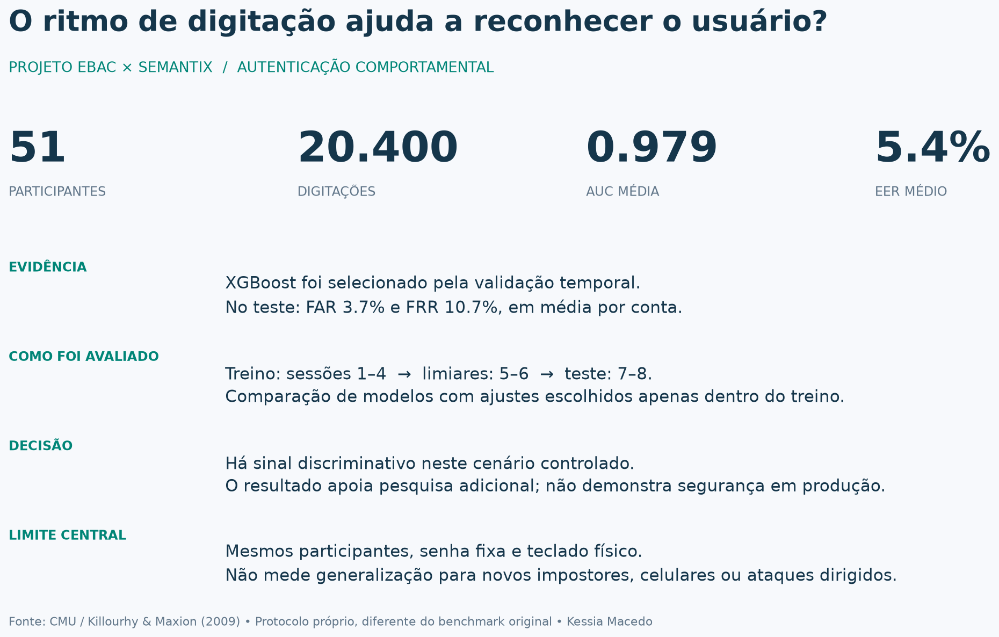

# Autenticação biométrica por padrão de digitação

**Kessia Macedo · Projeto EBAC × Semantix · Portfólio de Ciência de Dados**

É possível distinguir quem conhece uma senha de quem costuma digitá-la? Este estudo usa tempos de digitação para reconhecer o titular de uma conta e mostra o custo dos erros de autenticação.



## Coleta de dados

Base pública [CMU Keystroke Dynamics](https://www.cs.cmu.edu/~keystroke/), de Killourhy e Maxion (2009). A conferência local encontrou 20.400 linhas, 51 participantes e 31 medidas de tempo, sem nulos ou duplicatas. A origem, o dicionário, a integridade e a EDA estão no [relatório técnico](docs/RELATORIO.md#coleta-de-dados).

## Modelagem

Um classificador por conta compara o genuíno aos demais participantes. Treino nas sessões **1–4**, limiares em **5–6**, teste em **7–8**. Dois folds progressivos dentro do treino selecionam configurações; metadados de identidade e sessão não entram como preditores.

Comparamos baseline ingênuo, regressão logística, árvore de decisão e XGBoost. PCA e K-means são usados como análises exploratórias. O **XGBoost** é selecionado pela AUC na validação, antes do teste.

| Modelo | AUC ↑ | EER ↓ | FAR ↓ | FRR ↓ |
|---|---:|---:|---:|---:|
| Sempre rejeitar | 0,5000 | 50,00% | 0,00% | 100,00% |
| Regressão logística | 0,9559 | 8,61% | 8,54% | 11,16% |
| Árvore de decisão | 0,8584 | 18,21% | 8,02% | 22,33% |
| XGBoost | 0,9791 | 5,38% | 3,75% | 10,75% |


Médias entre 51 contas no teste. FAR: impostores aceitos; FRR: genuínos rejeitados. EER é calculada pela curva ROC e não representa o erro do limiar operacional. [Detalhes do protocolo](docs/RELATORIO.md#modelagem).

## Conclusões

O ritmo de digitação contém sinal discriminativo neste conjunto. O melhor modelo selecionado atinge AUC **0,9791**, mas ainda aceita **3,75%** dos impostores e bloqueia **10,75%** dos genuínos. A FRR chega a **83%** em uma conta: a média não descreve todos os usuários.

O resultado apoia investigação como camada complementar. Não demonstra segurança em produção, desempenho em celulares ou generalização para novos impostores. O protocolo difere do benchmark original. [Conclusões e limitações completas](docs/RELATORIO.md#conclusões).

## Como consultar

- Abra **[VISUALIZAR.html](VISUALIZAR.html)** no navegador para uma apresentação local, sem instalar nada.
- Leia **[docs/RELATORIO.md](docs/RELATORIO.md)** para a documentação completa nos três tópicos obrigatórios.
- Abra **[o notebook final](notebooks/projeto_autenticacao_digitacao_final.ipynb)** no Jupyter ou VS Code.
- Consulte **[docs/ENTREGA.md](docs/ENTREGA.md)** para o roteiro de imagens e futura publicação.

## Como reproduzir

Ambiente executado: Python **3.14.6**. As versões usadas estão fixadas em `requirements.txt`; diferenças de versões ou plataformas podem alterar resultados numéricos.

```bash
python -m venv .venv
source .venv/bin/activate
python -m pip install -r requirements.txt
python src/download_data.py
python src/analysis.py
python -m unittest discover -s tests -v
```

No Windows, ative com `.venv\Scripts\activate`. O CSV já está incluído; baixar novamente é opcional. XGBoost no macOS pode exigir a biblioteca OpenMP disponível no ambiente. O notebook usa, por padrão, os resultados incluídos; altere `RECALCULAR = True` para executar novamente a análise inteira. O comando de análise regenera resultados e cinco figuras; a documentação narrativa descreve a execução entregue e deve ser revisada se o protocolo mudar.

## Estrutura

```text
├── README.md
├── VISUALIZAR.html
├── requirements.txt
├── data/                 # CSV público e referência
├── docs/                 # Relatório e roteiro de entrega
├── figures/              # Cinco visualizações e síntese documental
├── notebooks/            # Notebook com saídas salvas
├── results/              # Métricas, limiares, previsões e validação
├── src/                  # Download verificado e análise completa
└── tests/                # Verificação das métricas biométricas
```

## Estado e atribuição

**Entrega local concluída; publicação no GitHub e envio à plataforma pendentes.** O trabalho foi concluído a partir do notebook inicial de coleta e inspeção. Dados de terceiros continuam sujeitos às condições de sua fonte; nenhuma licença substituta foi atribuída a eles. Referência: Killourhy & Maxion, DSN 2009, p. 125–134, [CMU](https://www.cs.cmu.edu/~keystroke/).
