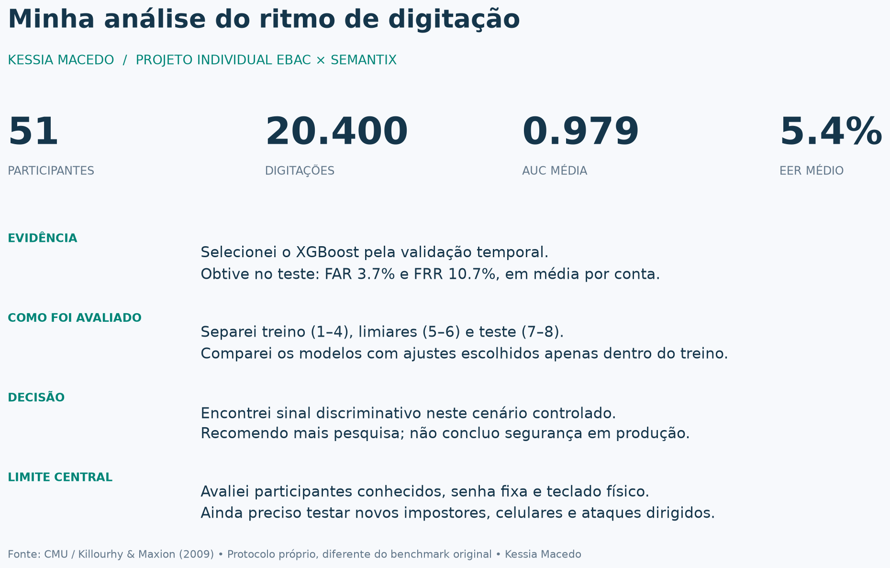
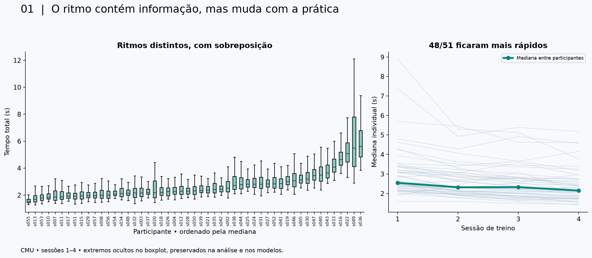
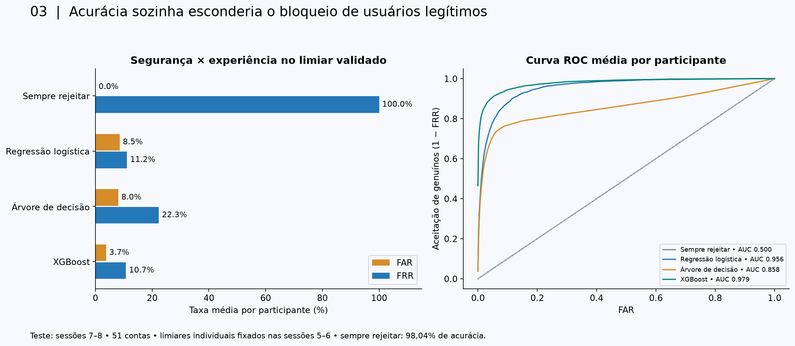

# Autenticação biométrica por padrão de digitação

**Kessia Macedo · Projeto EBAC × Semantix · Ciência de Dados**

Desenvolvi este projeto **individualmente, sem participação em grupo**, para investigar uma pergunta: **consigo distinguir o titular de uma conta de outra pessoa que conhece a mesma senha, usando o ritmo da digitação?**

Analisei dados públicos, comparei modelos de classificação e avaliei separadamente os erros de segurança e de experiência do usuário. Neste repositório, apresento meu processo completo, os resultados que obtive e as limitações do estudo.



**Para conhecer meu trabalho:** [relatório completo](docs/RELATORIO.md) · [notebook executado](notebooks/projeto_autenticacao_digitacao_final.ipynb) · [visualizações](figures) · [roteiro de entrega](docs/ENTREGA.md)

## Coleta de dados

Utilizei a base pública [CMU Keystroke Dynamics](https://www.cs.cmu.edu/~keystroke/), de Killourhy e Maxion (2009). Trabalhei com **20.400 digitações, 51 participantes e 31 medidas de tempo**. Conferi a integridade do arquivo e não encontrei valores ausentes ou linhas duplicadas.

Escolhi esse problema porque conhecer uma senha não garante que quem a digitou seja o titular da conta. Usei Machine Learning para combinar os tempos de digitação e investigar seu potencial como informação complementar de autenticação.

Na análise exploratória, observei diferenças entre pessoas e mudanças com a prática: **48 dos 51 participantes ficaram mais rápidos entre as sessões 1 e 4**. Também explorei PCA e K-means. Documentei a origem e as condições de uso em [data/README.md](data/README.md).



## Modelagem

Construí um classificador por conta, comparando o participante genuíno aos demais. Comparei uma referência que sempre rejeita a tentativa, regressão logística, árvore de decisão e XGBoost.

Separei os dados por sessão para avaliar digitações posteriores:

| Etapa | Sessões | Como utilizei os dados |
|---|---|---|
| Treino | 1–4 | Ajustei os modelos e selecionei configurações com dois folds temporais internos |
| Validação | 5–6 | Escolhi um limiar de decisão para cada conta |
| Teste | 7–8 | Avaliei os resultados após fixar os modelos e limiares |

Excluí identidade, sessão e repetição dos preditores. Ajustei a padronização apenas no treino. Selecionei o **XGBoost pela AUC na validação temporal**, antes de consultar o teste.

### Resultados que obtive no teste

| Modelo | AUC ↑ | EER ↓ | FAR ↓ | FRR ↓ |
|---|---:|---:|---:|---:|
| Sempre rejeitar | 0,5000 | 50,00% | 0,00% | 100,00% |
| Regressão logística | 0,9559 | 8,61% | 8,54% | 11,16% |
| Árvore de decisão | 0,8584 | 18,21% | 8,02% | 22,33% |
| **XGBoost** | **0,9791** | **5,38%** | **3,75%** | **10,75%** |

Apresento médias entre as 51 contas. **FAR** mede impostores aceitos e **FRR** mede usuários genuínos rejeitados. Calculei a **EER** pela curva ROC; ela não representa os erros do limiar operacional. Usei os limiares de validação para calcular FAR e FRR no teste.

Não usei acurácia como critério principal: rejeitar todas as tentativas produziria 98,04% de acurácia, mas bloquearia todos os usuários legítimos. Detalhei as escolhas, os hiperparâmetros e as métricas no [relatório técnico](docs/RELATORIO.md#modelagem).



## Conclusões

Concluí que o ritmo de digitação contém informação útil neste cenário. Com o XGBoost, obtive **AUC média de 0,9791**, mas ainda observei **3,75% de aceitações de impostores** e **10,75% de rejeições de usuários legítimos**.

Também identifiquei diferenças importantes entre contas: a rejeição de genuínos chegou a **83% em uma delas**. Por isso, considero o resultado uma prova de conceito e recomendo investigação adicional como camada complementar de autenticação.

**Não concluo que o modelo esteja pronto para produção.** Avaliei uma senha fixa, teclado físico e participantes conhecidos. Ainda preciso testar novos impostores, outros dispositivos e ataques dirigidos. Meu protocolo difere do benchmark original da CMU, portanto não comparo diretamente meus números aos publicados pelos autores.

## Como organizei o repositório

```text
├── README.md
├── VISUALIZAR.html        # Apresentação para abrir localmente no navegador
├── requirements.txt      # Versões do ambiente executado
├── data/                 # Base pública e referência
├── docs/                 # Relatório e roteiro de entrega
├── figures/              # Seis imagens com análises e documentação
├── notebooks/            # Notebook final com saídas salvas
├── results/              # Métricas, limiares, previsões e validação
├── src/                  # Download verificado e análise completa
└── tests/                # Testes das métricas e auditoria das previsões
```

## Como reproduzir meus resultados

Executei o projeto com **Python 3.14.6** e registrei as versões em [requirements.txt](requirements.txt). Na pasta do projeto:

```bash
python -m venv .venv
source .venv/bin/activate
python -m pip install -r requirements.txt
python src/analysis.py
python -m unittest discover -s tests -v
```

No Windows, a ativação é `.venv\Scripts\activate`. Incluí o CSV oficial; para baixá-lo novamente e verificar seu MD5, basta executar `python src/download_data.py`. No macOS, o XGBoost pode exigir a biblioteca OpenMP no ambiente.

Preparei o [notebook](notebooks/projeto_autenticacao_digitacao_final.ipynb) para consultar os resultados incluídos. A opção `RECALCULAR = True` executa novamente a análise. O script regenera resultados e seis gráficos; documentei a execução entregue e recomendo revisar a narrativa se houver mudanças no protocolo. Diferenças de ambiente podem alterar resultados numéricos.

Validei **quatro testes**, executei o notebook e conferi as métricas das **204 combinações de modelo e conta** diretamente nas previsões salvas. Registrei essa conferência em [results/verification.json](results/verification.json).

Para consultar a apresentação offline, basta baixar o repositório e abrir **VISUALIZAR.html**. No GitHub, o relatório em Markdown e o notebook são as versões de leitura direta.

## Autoria e referências

Sou **Kessia Macedo** e realizei este trabalho individualmente como parte do Projeto de Parceria EBAC × Semantix. Os dados foram disponibilizados pelos pesquisadores da CMU; a coleta original é de autoria deles.

- Killourhy, K. S.; Maxion, R. A. *Comparing Anomaly Detectors for Keystroke Dynamics*. DSN 2009, p. 125–134. [Fonte e dados](https://www.cs.cmu.edu/~keystroke/).
- Scikit-learn. [Boas práticas para evitar vazamento de dados](https://scikit-learn.org/stable/common_pitfalls.html).
- XGBoost. [Documentação dos parâmetros](https://xgboost.readthedocs.io/en/stable/parameter.html).

Mantive a atribuição aos autores da base e não atribuí uma licença substituta aos dados. Registrei as limitações e os cuidados com perfis comportamentais no [relatório](docs/RELATORIO.md#conclusões).
