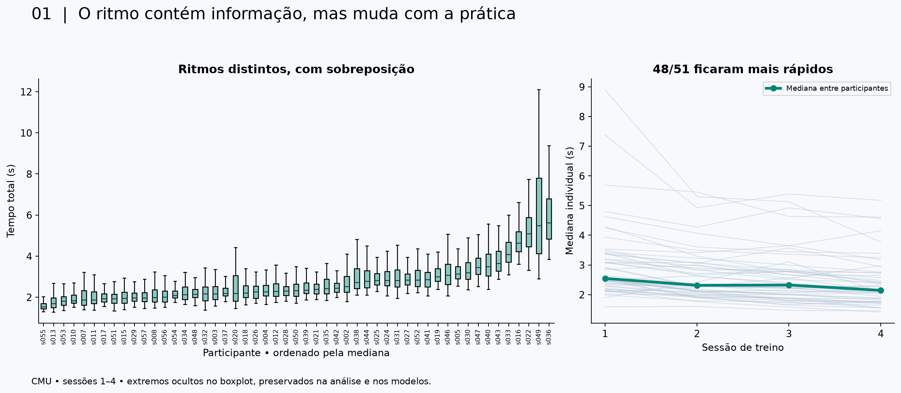
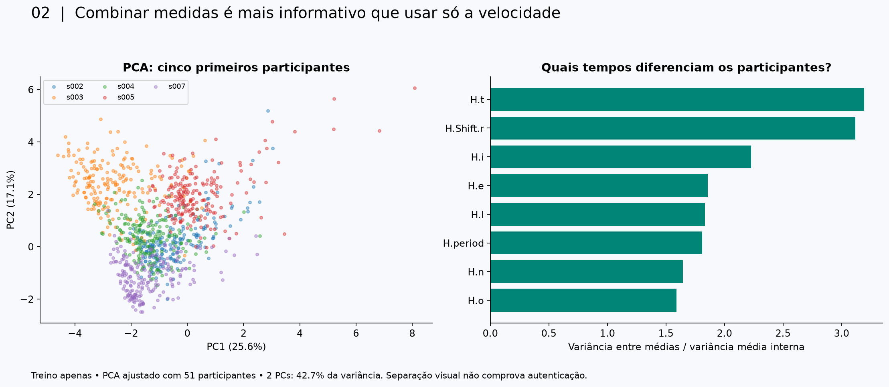
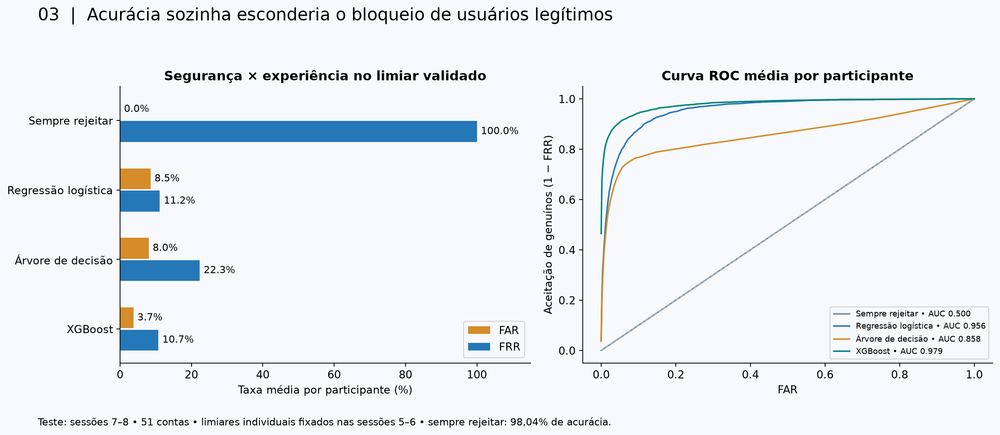
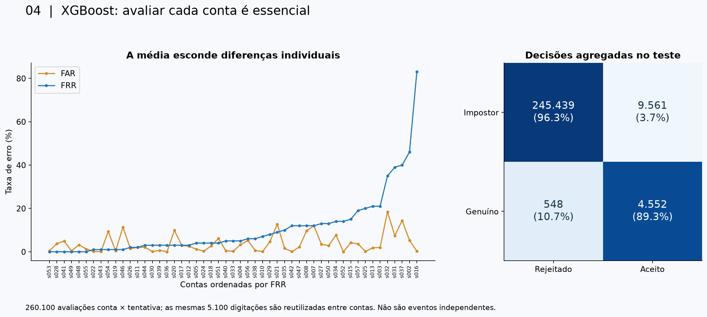

# Relatório técnico — Autenticação por padrão de digitação

**Autora:** Kessia Macedo · **Projeto:** EBAC × Semantix · **Versão final:** 24/11/2026

Desenvolvi este projeto individualmente, sem participação em grupo. Neste relatório, apresento minhas escolhas, meus resultados e as limitações que identifiquei.

## Coleta de dados

### Problema e objetivo de negócio

Conhecer a senha não demonstra, por si só, que quem a digitou é o dono da conta. Neste projeto, investigo se o ritmo da digitação acrescenta informação para distinguir um participante dos demais. A decisão estudada é aceitar ou rejeitar uma tentativa em uma conta cadastrada. O custo de aceitar um impostor é diferente do custo de bloquear um usuário legítimo; por isso apresento esses erros separadamente.

O aprendizado de máquina é pertinente porque combina várias medidas de tempo e aprende diferenças entre pessoas. Uma regra baseada apenas na duração total perderia padrões individuais. Desenvolvi uma prova de conceito acadêmica e não um sistema de autenticação pronto para uso.

### Fonte, acesso e integridade

Utilizei o [benchmark público da CMU](https://www.cs.cmu.edu/~keystroke/), de Killourhy e Maxion (2009), com participantes identificados por códigos. São 51 pessoas, 400 registros por pessoa, oito sessões e 50 repetições por sessão. A senha experimental comum é `.tie5Roanl`, seguida de Enter. O arquivo contém 20.400 linhas e 34 colunas. Não coletei senhas reais nem novos dados de pessoas.

Conferi o [CSV oficial](https://www.cs.cmu.edu/~keystroke/DSL-StrongPasswordData.csv) em 24/11/2026. Seu MD5 é `470235f96568f28f9ea0da62234ec857`. Minha cópia original tinha os mesmos valores tabulares, embora os bytes fossem diferentes. Incluí o arquivo oficial, o verificador de integridade e a referência da fonte. Identificadores codificados não garantem anonimato absoluto.

### Dicionário e qualidade

`subject` identifica o participante; `sessionIndex`, a sessão; `rep`, a repetição. São metadados, excluídos das entradas dos modelos. As 31 entradas são 11 tempos H (tecla pressionada), 10 DD (entre pressionamentos) e 10 UD (entre liberação e próximo pressionamento), em segundos. UD pode ser negativo; existe a relação DD = H + UD.

Na conferência local, encontrei **zero nulos, zero linhas duplicadas e zero chaves repetidas** em participante/sessão/repetição. Todas as combinações participante/sessão têm 50 linhas. Os dados são balanceados entre identidades, mas cada problema de autenticação é desbalanceado: um genuíno para 50 impostores.

### Análise exploratória

Usei apenas as sessões 1–4 na EDA que orienta minhas escolhas e nas figuras exploratórias. Estatísticas descritivas completas ficam em `results/descriptive_statistics.csv`, sem serem usadas para selecionar modelos.

- **Ritmo individual:** observei que as medianas do tempo total no treino variam de 1,53 a 5,61 segundos. Há diferenças e sobreposição; velocidade isolada não identifica todas as pessoas.
- **Efeito de prática:** observei que 48 de 51 participantes têm mediana menor na sessão 4 que na sessão 1. A mediana das mudanças individuais é -18,94%. Isso descreve associação com a sessão, sem provar causalidade.
- **Valores extremos:** preservei esses valores nos modelos, pois não encontrei justificativa para remover pausas como se fossem erros de medição. Os boxplots escondem apenas os marcadores de extremos. Não há imputação ou recorte aprendido sobre o teste.
- **Tempos negativos:** mantive os 8.503 valores UD negativos do treino, coerentes com sobreposição de teclas, sem corrigi-los para zero.
- **Separação entre pessoas:** identifiquei que a maior razão entre variância das médias individuais e variância média dentro de cada indivíduo ocorre em `H.t`. É uma medida descritiva univariada, não uma importância causal do modelo.
- **Álgebra linear e PCA:** padronizei as variáveis no treino e observei que duas componentes explicam 42,71% da variância. São necessárias 17 componentes para 95%. Na figura, mostro os cinco primeiros códigos em ordem, sem procurar um subconjunto mais favorável. A redundância algébrica entre H, DD e UD motiva esse diagnóstico.
- **K-means:** como exploração complementar, usei k=51 nas componentes que retêm 95% da variância, somente no treino. O índice de Rand ajustado foi 0,235. Não é uma validação de autenticação; os clusters não correspondem perfeitamente a pessoas e k foi fixado pelo número conhecido de participantes.

**Revisão das hipóteses iniciais:** H1 recebe suporte descritivo, com sobreposição; H2 é compatível com a redução observada, sem teste causal. H3 não recebe suporte claro: a transição para maiúscula não lidera a medida usada. H4 permanece parcialmente explorada: tempos H aparecem no topo da razão de separação, mas isso não substitui um teste formal de estabilidade comparativa. Não realizei testes de significância dessas hipóteses.

## Modelagem

### Formulação supervisionada

Construí **51 classificadores binários por família**, um para cada conta. Classe 1 significa genuíno; classe 0 significa outro participante. As mesmas identidades aparecem em sessões diferentes em treino, validação e teste. Esse desenho mede novas digitações de participantes conhecidos; não mede generalização para novos impostores.

Forneci as 31 medidas originais a todos os modelos. `subject`, sessão, repetição e tempo total calculado não entram como preditores. PCA e K-means são diagnósticos exploratórios e não alimentam os classificadores.

### Protocolo temporal e prevenção de vazamento

| Etapa | Sessões | Linhas únicas | Genuínas por conta | Impostoras por conta |
|---|---|---:|---:|---:|
| Treino final | 1–4 | 10.200 | 200 | 10.000 |
| Validação de limiar | 5–6 | 5.100 | 100 | 5.000 |
| Teste final | 7–8 | 5.100 | 100 | 5.000 |

Otimizei as configurações **dentro das sessões 1–4**, em dois folds progressivos: treinar em 1–2 e avaliar em 3; treinar em 1–3 e avaliar em 4. Cada configuração recebe a média de AUC entre os 51 participantes e os dois folds. Apliquei a mesma configuração escolhida a todas as contas da família. Selecionei a família com maior média nessa validação, sem usar o teste para essa escolha.

Depois, ajustei cada modelo em 1–4. Escolhi o limiar individual em 5–6 para minimizar a diferença absoluta entre FAR e FRR; em empate, escolhi a menor FAR. A decisão é `score >= limiar`. Não reajustei o modelo após escolher o limiar. Reservei as sessões 7–8 somente para avaliação final. Não embaralhei linhas entre sessões. Ajustei a padronização da regressão separadamente em cada treino por meio de um pipeline, conforme as [boas práticas do scikit-learn](https://scikit-learn.org/stable/common_pitfalls.html).

Não há sobreposição de registros entre as três etapas; há **sobreposição intencional de identidades**, uma limitação do cenário fechado. A pequena quantidade de sessões também limita a variedade temporal avaliada.

### Modelos e escolhas técnicas

| Família | Justificativa | Configuração |
|---|---|---|
| Sempre rejeitar | Referência ingênua que expõe a fragilidade da acurácia | Score constante; todas as tentativas rejeitadas |
| Regressão logística | Baseline supervisionado linear, regularizado | StandardScaler, C=1, pesos balanceados, máximo de 2.000 iterações |
| Árvore de decisão | Regras não lineares e interações; controle de complexidade | Busca: profundidades 4/8 e mínimos de 5/20 linhas por folha |
| XGBoost | Combinação sequencial de árvores para capturar interações | Busca: profundidades 2/3, 120 árvores; taxa 0,08; peso positivo 50 |

Árvore selecionada: profundidade **4**, mínimo **20** por folha. XGBoost selecionado: profundidade **3**, **120** árvores. `subsample=1`, `colsample_bytree=1`, método `hist`, duas threads e semente 42. A busca é pequena e declarada; não representa otimização exaustiva. Detalhes dos parâmetros estão na [documentação oficial do XGBoost](https://xgboost.readthedocs.io/en/stable/parameter.html).

A ponderação preserva todos os exemplos e dá mais peso à classe rara durante o ajuste. Não usei oversampling. Não apresento os scores de saída como probabilidades calibradas: com pesos de classe e prevalência experimental, um score de 0,9 não significa 90% de certeza operacional.

### Métricas e critério de seleção

- **FAR = FP / (FP + TN):** proporção de impostores aceitos.
- **FRR = FN / (FN + TP):** proporção de genuínos rejeitados.
- **AUC-ROC:** capacidade de ordenar genuínos acima de impostores ao variar o limiar.
- **EER:** interseção aproximada entre FAR e FRR, obtida por interpolação linear da ROC. É uma medida descritiva de separação, não o erro observado no limiar operacional. Com scores discretos, a interseção interpolada pode não ser atingível por um único limiar determinístico.

A implementação usa a orientação de classe positiva da [ROC do scikit-learn](https://scikit-learn.org/stable/modules/generated/sklearn.metrics.roc_curve.html). Calculei as métricas por conta e depois apliquei a média simples (**macro**). Todas as contas têm o mesmo número de exemplos. Desvio-padrão e extremos estão nos CSVs; não são intervalos de confiança.

Não usei acurácia como critério de seleção: sempre rejeitar produz 98,04% de acurácia, mas FRR de 100%. O critério de AUC é útil para esta comparação acadêmica, porém não incorpora os custos de fraude e bloqueio. Um produto real precisaria de uma meta de FAR definida pelo negócio e validação independente do limiar.

### Avaliação executada

AUC de validação temporal da melhor configuração: regressão **0,9637**, árvore **0,8746**, XGBoost **0,9939**. Portanto, **selecionei o XGBoost antes de avaliar o teste**.

| Modelo | AUC ↑ | EER ↓ | FAR ↓ | FRR ↓ |
|---|---:|---:|---:|---:|
| Sempre rejeitar | 0,5000 | 50,00% | 0,00% | 100,00% |
| Regressão logística | 0,9559 | 8,61% | 8,54% | 11,16% |
| Árvore de decisão | 0,8584 | 18,21% | 8,02% | 22,33% |
| XGBoost | 0,9791 | 5,38% | 3,75% | 10,75% |

Todos os valores acima são do teste nas sessões 7–8. FAR e FRR usam os limiares fixados nas sessões 5–6; EER varre o score apenas para descrição. Uma EER de 5,38% não significa que os dois erros operacionais foram de 5,38%.

No XGBoost, a matriz agregada contém **245.439 impostores rejeitados, 9.561 impostores aceitos, 548 genuínos rejeitados e 4.552 genuínos aceitos**. São 260.100 avaliações conta × tentativa, construídas a partir de 5.100 digitações únicas. Reusar uma digitação contra várias contas cria dependência; não tratei esses pares como observações independentes para inferência.

A FRR varia de **0% a 83%** entre contas, com desvio-padrão de **14,98 pontos percentuais**. A média oculta usuários com experiência muito pior. AUC também cai de 0,9939 na validação temporal para 0,9791 no teste, o que reforça a importância de avaliar sessões posteriores.

## Conclusões

### Resposta ao problema

Concluí que há informação útil no ritmo de digitação para distinguir participantes neste cenário. Entre as configurações que comparei, o XGBoost que selecionei pela validação alcançou AUC média **0,9791** e EER média **5,38%**. No limiar escolhido antes do teste, aceitou **3,75%** das tentativas de outros participantes e bloqueou **10,75%** das tentativas genuínas.

Recomendo seguir com pesquisa e validação de uma camada complementar de autenticação, mantendo uma alternativa de verificação para o usuário. **O experimento não justifica implantação autônoma em produção.** A aceitação de impostores e o bloqueio de genuínos continuam relevantes, e os erros variam substancialmente entre contas.

### Limitações

1. **Cenário fechado:** negativos de teste pertencem a pessoas que já forneciam negativos no treino. Futuros experimentos devem separar identidades impostoras entre treino e teste.
2. **Domínio restrito:** uma senha fixa, teclado físico e ambiente controlado. Não há evidência direta para telas de celular, senhas variadas, dispositivos diferentes ou digitação livre.
3. **Ataques não simulados:** outras pessoas digitando a senha não reproduzem necessariamente um ataque dirigido, imitação ou injeção de eventos.
4. **Amostra e repetição:** 51 participantes não representam a população geral; sessões e avaliações entre contas são dependentes. Não fiz inferência populacional ou testes formais de superioridade.
5. **Escolha de limiar:** equilibrar erros na validação não garante FAR/FRR iguais no futuro, nem atende uma exigência de segurança definida por negócio.
6. **Comparação externa:** meu protocolo supervisionado, negativos e partições diferem do experimento original da CMU. Seus resultados publicados não são diretamente comparáveis aos meus.
7. **Privacidade:** um eventual produto requer avaliação própria da coleta, finalidade, retenção, controle de acesso e proteção dos perfis comportamentais. Este relatório não estabelece uma base jurídica para uso comercial.

### Próximos passos

Pretendo definir o custo de cada erro e uma meta de FAR; testar impostores não vistos; ampliar o número de sessões e dispositivos; avaliar mudança de comportamento; analisar estabilidade dos limiares e probabilidades calibradas; comparar um detector treinado apenas com o genuíno; e usar desenho de validação que respeite a dependência entre sessões e pessoas.

### Reprodutibilidade e transparência da entrega

Comecei pela coleta, inspeção e um gráfico inicial. Na versão final, **completei e executei a EDA ampliada, a modelagem e a avaliação**. Organizei o projeto para permitir a reprodução dos resultados. Mantive o histórico do rascunho nos commits anteriores e retirei seus campos de documentos pessoais da apresentação final.

A análise integral está em `src/analysis.py`. O notebook final apresenta os dados e resultados salvos e contém uma opção explícita de recalcular tudo. `results/predictions.csv.gz` permite reconstruir métricas; `metrics_by_subject.csv`, os limiares e contagens; `cv_details.csv`, cada avaliação de validação; `run_manifest.json`, versões e integridade. Quatro testes verificam orientação de classes, empates, denominadores e reprodução das métricas a partir das previsões salvas. A análise também verifica esquema e integridade das partições.

**Meu repositório:** [kessiagmacedo/Projeto-Semantix](https://github.com/kessiagmacedo/Projeto-Semantix). Organizei o material para entrega; o envio na plataforma do curso é uma etapa separada.

### Referências

- Killourhy, K. S.; Maxion, R. A. *Comparing Anomaly Detectors for Keystroke Dynamics*. DSN 2009, p. 125–134. [Fonte e dados](https://www.cs.cmu.edu/~keystroke/).
- Scikit-learn. [Common pitfalls and recommended practices](https://scikit-learn.org/stable/common_pitfalls.html) e [ROC curve](https://scikit-learn.org/stable/modules/generated/sklearn.metrics.roc_curve.html).
- XGBoost. [Parameters](https://xgboost.readthedocs.io/en/stable/parameter.html).

Fontes consultadas em 24/11/2026. As métricas e interpretações numéricas são resultados desta execução local.
